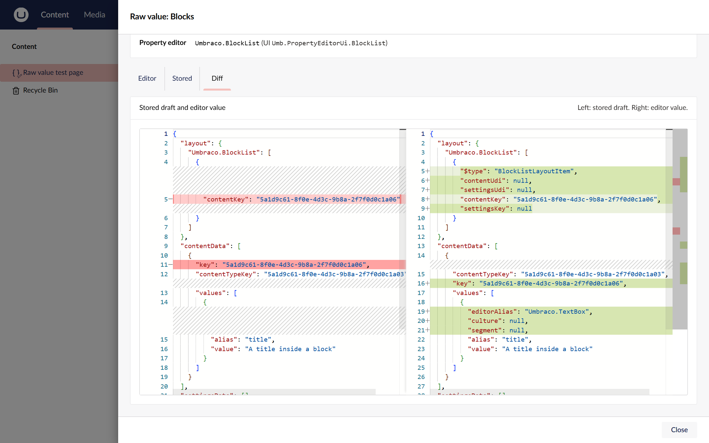

# Umbraco Property JSON Viewer

See and fix the raw value Umbraco stores for any document property, right from the backoffice. It adds **View raw
value** to the "..." menu of every property, next to Umbraco's own Copy and Clear, and works with any property
editor, including ones from other packages. Install the package and give the right user groups the new permission;
there is nothing else to configure. You can then see exactly what is in the database, compare it with what the
property editor holds, and, with a second permission, write a corrected value straight to the draft.



> **Not yet on NuGet.** The first release is being prepared. Until then, build it from source (see
> [Contributing](CONTRIBUTING.md)).

| Umbraco | Package |
| --- | --- |
| 17.x | 17.x |
| 18.x | 18.x |

## Features

**Debug a property editor**

- **See what is stored.** The **Stored** tab shows the draft and published values exactly as the database holds
  them, before any property editor conversion. JSON is pretty-printed.
  [View a stored value](docs/how-to/view-a-stored-value.md)
- **See what the editor holds.** The **Editor** tab shows the value the property editor has now, unsaved edits
  included, and updates as you type.
- **Spot the difference.** The **Diff** tab puts the stored draft and the editor value side by side. Block lists,
  pickers and rich text often hold a different shape in the editor from the one they store, and that difference is
  usually the bug. [Compare with the editor](docs/how-to/compare-with-the-editor.md)

**Repair a broken value**

- **Write a raw value.** Edit the stored draft and save it straight to the database, bypassing the property
  editor. Useful when the editor cannot load the value it is meant to repair.
  [Fix a stored value](docs/how-to/fix-a-stored-value.md)
- **With the guard rails up.** A warning, a review of the change, confirmation by typing the property alias, and a
  refusal while the page has unsaved edits. Every save is a new version you can roll back.

**Stay in control**

- **Two permissions, nobody has them by default.** "View raw property values" and "Write raw property values" sit
  with the other document permissions, so you can grant them per user group or per document.
  [Give users access](docs/how-to/give-users-access.md)
- **One switch to turn it off.** `PropertyJsonViewer:Enabled` hides the whole feature.
  [Configuration](docs/reference/configuration.md)

## Install

The package needs Umbraco 17 or 18 on .NET 10. Install the version line that matches your Umbraco major:

```sh
dotnet add package Umbraco.Community.PropertyJsonViewer
```

## Quick start

1. Go to **Users > User Groups**, open the group that should use it (for example **Administrators**), turn on
   **View raw property values** under **Property JSON Viewer**, and choose **Save**.
2. Open any document. Hover over a property and choose the **...** menu next to its label.
3. Choose **View raw value**. The drawer opens on the **Stored** tab.

For writing raw values, also turn on **Write raw property values**, then follow
[Fix a stored value](docs/how-to/fix-a-stored-value.md).

## Documentation

Start at the [documentation index](docs/index.md):

- **How-to guides:** [view a stored value](docs/how-to/view-a-stored-value.md),
  [compare with the editor](docs/how-to/compare-with-the-editor.md),
  [fix a stored value](docs/how-to/fix-a-stored-value.md), [give users access](docs/how-to/give-users-access.md).
- **Reference:** [configuration, permissions and API](docs/reference/configuration.md).
- **Explanation:** [stored values and editor values](docs/explanation/stored-and-editor-values.md).

## Contributing

Building, running the sample sites and testing: [CONTRIBUTING.md](CONTRIBUTING.md). Changes are listed in the
[changelog](CHANGELOG.md).

## Licence

[MIT](LICENSE)
