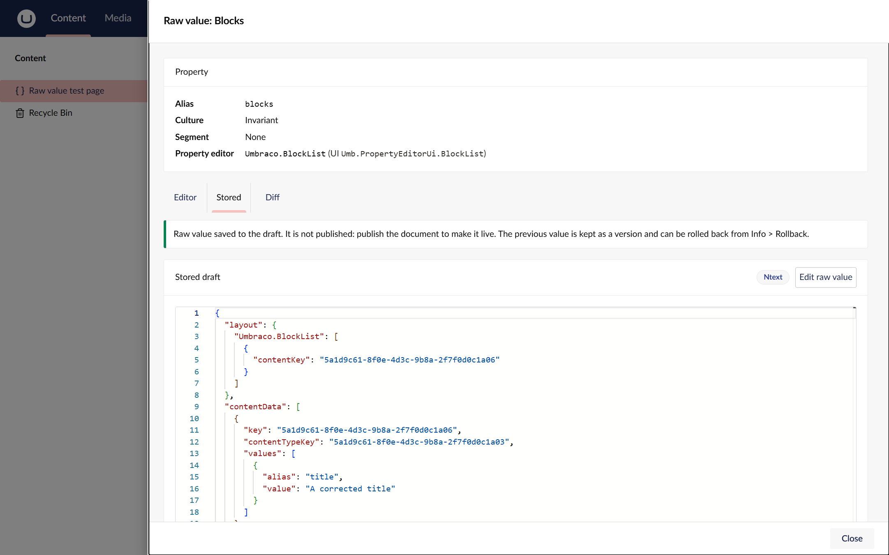

# Fix a stored value

Writing a raw value saves exactly what you type to the document's draft. It skips the property editor's conversion
and validation, so you can repair a value the editor cannot load. It also means a mistake can break the property for
every editor until someone fixes or rolls it back. Work carefully.

You need all of these on the document:

- **Write raw property values**
- Umbraco's **Update** permission, for the language you are editing
- Write access to the property (the **UI Write** document property value permission)

See [Give users access](give-users-access.md).

## Save a corrected value

1. Save or discard any changes on the page first. The drawer refuses to save while the document has unsaved
   changes, because saving the page afterwards would write the old value back over yours.
2. Open the drawer on the property and choose the **Stored** tab.
3. Choose **Edit raw value**. The stored draft opens for editing, under a warning.
4. Make your change, then choose **Review changes**.
5. Check the difference. The stored draft is on the left and the value you are about to save is on the right.

   

6. Type the property alias in the box to confirm. It must match exactly, including case.
7. Choose **Save raw value**.

The document reloads with the new value. The value is saved to the draft only.

## After saving

- **Publish** the document when you are ready for visitors to see the change. The raw save never publishes.
- **To undo it**, open the document's **Info** tab and roll back to the previous version. Every raw save is a new
  version.

## What the server checks

The server rejects a value, and stores nothing, when:

- the stored value is JSON and the new value is not valid JSON;
- the property stores whole numbers, numbers or dates and the value is not one (use `.` for decimals and
  `yyyy-MM-dd HH:mm:ss` for dates);
- the property's column holds at most 512 characters and the value is longer;
- another part of the site cancels the save.

The drawer shows the reason. Valid JSON is saved compact, the way property editors save it. An empty value clears
the stored value.

You cannot write a property inside a block: its value lives inside the parent block property. Edit the block list or
block grid property's value instead.
