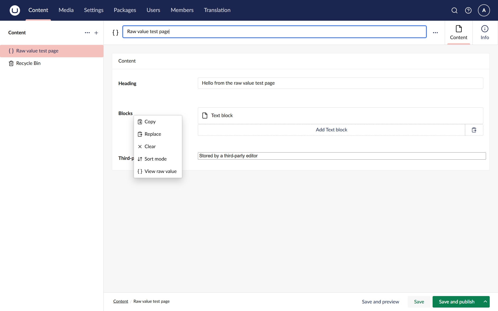
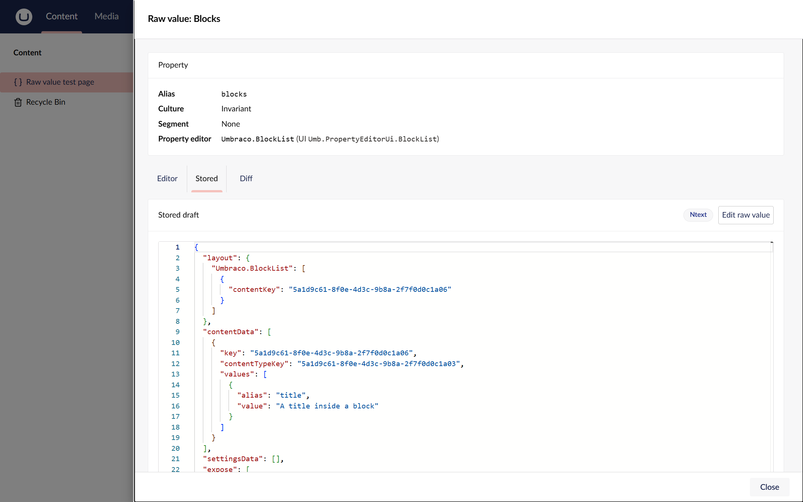
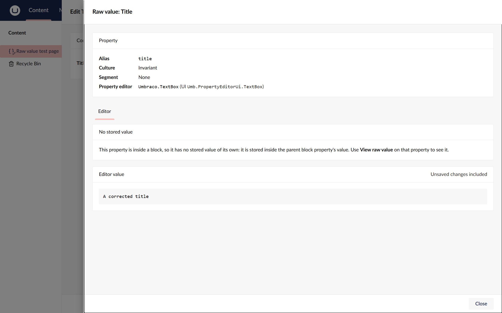

# View a stored value

You need the **View raw property values** permission on the document. See [Give users access](give-users-access.md).

1. Open the document in the **Content** section.
2. Hover over the property and choose the **...** menu next to its label.

   

3. Choose **View raw value**. The drawer opens.
4. Choose the **Stored** tab.

The tab shows:

- **Stored draft:** the value saved most recently, published or not.
- **Stored published:** the value visitors see, or "Not published."
- The **storage type** tag (for example `Ntext` or `Nvarchar`): the database column the value lives in.

JSON is pretty-printed. Anything else is shown exactly as stored. An empty value reads "No value stored".

## Culture and segment variants

The drawer shows the variant you are editing. Switch the workspace to another language or segment, then open the
drawer again to see that variant. A property that does not vary by culture shows the same value whichever language
you open it from.

## Properties inside blocks

A property inside a block has no stored value of its own: it is stored inside the parent block property's value. Its
drawer shows only the **Editor** tab and says so.

To see the stored value, choose **View raw value** on the block list or block grid property itself.
